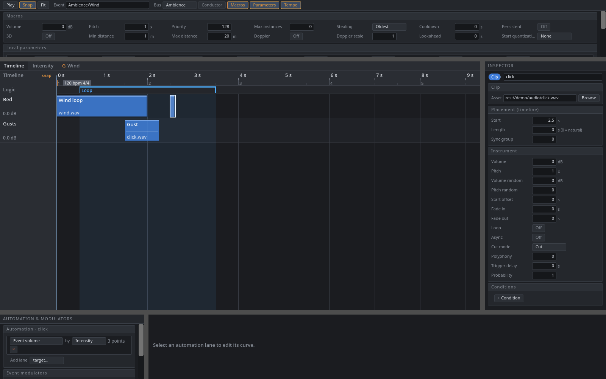
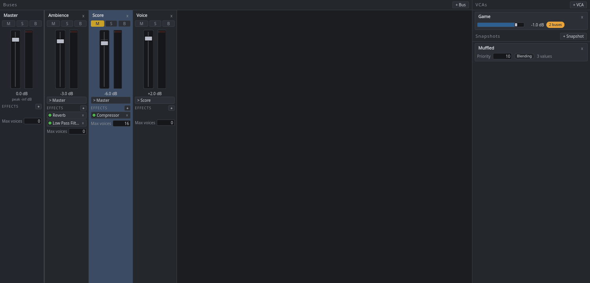
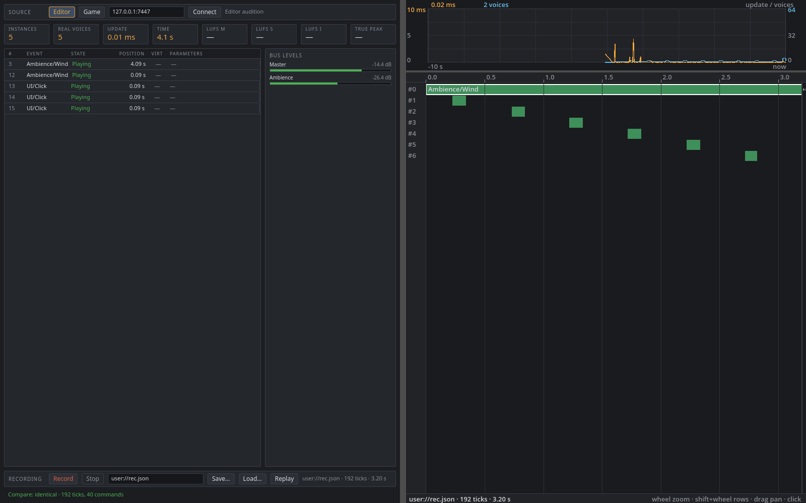
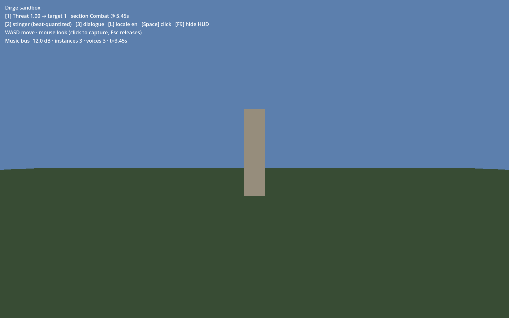

# Dirge

Adaptive audio authoring for stock Godot 4 .NET, in the FMOD Studio mould: events with timelines and parameter sheets, local and global parameters with automation and modulators, snapshots, VCAs and a mixer graph — all played through Godot's own `AudioServer`. The authoring tool is a Godot editor main screen built with HTML/CSS through [NecronomiDOM](https://github.com/Eldritch-Game-Studio/NecronomiDOM), and the same panes mount over a running game. MIT licensed.


| Event editor | Mixer |
|---|---|
|  |  |

| Profiler | 3D sandbox |
|---|---|
|  |  |

[Getting started](docs/getting-started.md) · [Capabilities and API reference](docs/capabilities.md) · [Specification](docs/SPEC.md) · [Changelog](CHANGELOG.md)

## What it is

- **A pure model.** `Dirge.Model` (`addons/dirge/model`) has no Godot reference: project graph, parameters, curves, modulators, snapshots, timeline logic, voice scheduling, serialization (`*.dirge.json`), validation, profiler recordings and ITU-R BS.1770-4 loudness. Each `Update(dt)` emits a deterministic command stream, which is what the unit tests, the profiler replay and the headless smoke tests assert on.
- **A Godot runtime.** `addons/dirge/runtime` hosts the model: `DirgeServer` drives `DirgeSystem` from `_Process`, `AudioDriver` applies the commands to `AudioServer` buses/effects and a pooled set of `AudioStreamPlayer`/`AudioStreamPlayer3D` nodes, `BankLoader` preloads streams, `LoudnessCapture` meters Master, `LiveUpdateHost` serves the editor and `DirgeOverlay` shows the Mixer/Profiler panes in-game.
- **A tool.** `addons/dirge/tool` adds the **Dirge** main screen to the editor: Browser, Transport with 3D preview panner, Event editor, Mixer, Profiler and Validation panel.
- **Optional native effects.** `native/` is a GDExtension adding aux send/return routing and convolution reverb, which stock `AudioServer` cannot express.

## Requirements

- Godot **4.7.2 .NET** (stock build) and a .NET SDK able to target `net8.0` (`global.json` pins 10.x with roll-forward).
- **NecronomiDOM ≥ 1.1.4** for the editor tool and the in-game overlay. The runtime alone (`DirgeServer`, `AudioDriver`, banks, loudness, live update) does not use it.
- Native effects: a C++17 compiler and SCons if you build them yourself; prebuilt binaries ship in the release ZIP under `addons/dirge/bin/<platform>/`.
- GDScript-only projects cannot use Dirge: the runtime is C# and needs the .NET edition. GDScript code in a .NET project can call the `DirgeServer` autoload directly (see the quick start).

## Install

1. Download the addon ZIP (`scripts/package.sh` builds `dist/Dirge-v<version>.zip`) and copy its `addons/dirge/` folder into your project.
2. Install NecronomiDOM into `addons/necronomidom/` — from its release ZIP, or in this repository with `scripts/fetch-deps.sh`.
3. Add both build imports to your project's `.csproj`, before `</Project>`:
   ```xml
   <Import Project="addons/necronomidom/NecronomiDom.targets" />
   <Import Project="addons/dirge/Dirge.targets" />
   ```
   `Dirge.targets` builds `Dirge.Model` as its own assembly and compiles `runtime/` and `tool/` into your game assembly.
4. Build (`dotnet build`), then enable **Dirge** in **Project → Project Settings → Plugins**. Enabling registers the `DirgeServer` and `DirgeOverlay` autoloads and adds the `dirge/project_path` project setting; disabling removes the autoloads.
5. Set **`dirge/project_path`** to your `*.dirge.json` file (the Dirge main screen's **Save As…** writes one). `DirgeServer` loads it in `_Ready`, rebuilds the `AudioServer` bus layout from the project's mixer graph (Master stays at index 0) and starts updating.

Alternatively place a `DirgeServer` node in a scene and set its `ProjectPath` export; the demo scenes do this.

## Quick start

GDScript, against the autoload:

```gdscript
var wind := DirgeServer.StartEvent("Ambience/Wind")      # int handle, 0 if the event is unknown
DirgeServer.SetParameter(wind, "Intensity", 0.8)
DirgeServer.SetGlobalParameter("Threat", 1.0)
DirgeServer.StartSnapshot("Muffled")
if DirgeServer.IsEventPlaying(wind):
    DirgeServer.StopEvent(wind, false)                     # false = allow fade-out
DirgeServer.StopSnapshot("Muffled")
var stats: Dictionary = DirgeServer.GetStats()           # time, instances, real_voices, update_ms, handles, *_lufs, true_peak_dbtp
```

Handle-started instances also emit signals: `EventStarted(handle)`, `EventStopped(handle)`, `TimelineMarker(handle, name, position)`, `TimelineBeat(handle, bar, beat, bpm, position)`, `SoundPlayed(handle, asset)`, `EventVirtualized`/`EventUnvirtualized`/`EventStolen(handle)` and `ProgrammerSound(handle, key)`, which a handler answers synchronously:

```gdscript
DirgeServer.TimelineBeat.connect(func(handle, bar, beat, bpm, position): print("beat ", bar, ":", beat))
DirgeServer.ProgrammerSound.connect(func(handle, key):
    DirgeServer.SetProgrammerSound(handle, "res://audio/vo/%s_%s.ogg" % [key, TranslationServer.get_locale()]))
DirgeServer.SetCallbackMask(wind, 0)                     # CallbackMask bits; 0 silences this handle's signals
```

C#, with the full instance API:

```csharp
using Dirge.Driver;
using Dirge.Runtime;

var server = GetNode<DirgeServer>("/root/DirgeServer");
DirgeSystem system = server.System;

EventDescription music = system.GetEvent("Music/Theme");
EventInstance instance = music.CreateInstance();
instance.Callback += (sender, callback) =>
{
    if (callback is BeatCallback beat) GD.Print($"bar {beat.Bar} beat {beat.Beat}");
};
instance.Start();
instance.SetParameter("Threat", 1f);
instance.Set3DAttributes(new Attributes3D(position, velocity, forward, up));
system.SetListener(0, new Attributes3D(cameraPosition, cameraVelocity, cameraForward, cameraUp));

instance.Stop(StopMode.AllowFadeout);
instance.Release();                       // destroyed once stopped

SnapshotInstance duck = system.Mixer.StartSnapshot("Duck");
duck.Intensity = 0.5f;
duck.Stop();
```

`Attributes3D` is the model's own vector type (`System.Numerics.Vector3`), so the model stays engine-free; convert from Godot vectors at the call site.

## Tool tour

- **Browser** (left): tabs for **Events** (folder tree by path — `+ Event`, `+ Folder`, rename, delete, drag to re-parent), **Assets** (every audio file under `res://` with its length; **Import lengths** stores them in the project so the model can schedule one-shots headless), **Snapshots**, **Parameters** (global) and **Banks**. Search filters the tree. Drag an asset onto the timeline to create a clip instrument, or an event to create a nested event instrument.
- **Transport** (top): **Play**/**Stop**/**Stop All**, **Loop**, global and per-event parameter sliders, instance/voice/update-time readouts and the **3D preview panner** — drag the emitter around the listener to drive the built-in `distance`, `direction`, `elevation`, cone angle, orientation and speed parameters while auditioning.
- **Event editor** (center): header with path, bus, **Macros** (volume, pitch, priority, max instances, stealing, cooldown, persistent, 3D, min/max distance, rolloff, doppler, lookahead, start quantization), **Parameters** (local) and **Tempo** map. Below it the timeline tab and one tab per parameter sheet, with tracks, instrument blocks, logic markers and the playhead; right-click for **Add instrument** (all eight kinds), **Add marker** (destination, loop, transition, transition region, magnet, sustain), **Add tempo marker here**, **Add track**, copy/paste/duplicate/delete and snap-to-grid. The **Inspector** edits the selected instrument, marker or track; **Automation & modulators** adds lanes (with a curve editor) and random/AHDSR/LFO modulators.
- **Mixer** (bottom tab): one strip per bus with fader, peak meter, **M**/**S**/**B**, routing picker, max voices and the effect chain (`+` lists every instantiable `AudioEffect` plus the Dirge native effects when the extension is loaded; click an effect for its parameter popover; drag effects to reorder, and drag the **FADER** row to split the chain into pre- and post-fader effects). **+ Bus**, **+ VCA**, **+ Snapshot**; selecting a snapshot opens its editor — touch a fader or effect parameter to scope it, **Capture** scopes every bus volume, set mode, priority and the intensity AHDSR, scrub intensity to hear it.
- **Profiler** (bottom tab): live instance list, real-voice count, update-time graph, per-bus levels, LUFS M/S/I and true peak, and **Record**/**Stop**/**Save…**/**Load…**/**Replay** for command recordings; the source toggle switches between the editor audition and a live game.
- **Validation** (bottom tab) and the **Validate** menu item list `ProjectValidator` diagnostics with stable codes; the status bar shows error/warning counts, instance/voice counts and the live-update state.
- Shortcuts: `Ctrl+Z`/`Ctrl+Shift+Z`/`Ctrl+Y` undo/redo, `Ctrl+S` save, `Ctrl+C`/`Ctrl+V`/`Ctrl+D` copy/paste/duplicate, `Ctrl+A` select all, `Space` play/stop, `Delete`.

## Live update

Run the game with `--dirge-live` after the `--` separator (`godot --path . -- --dirge-live` or `--dirge-live=7447`), or set `LiveUpdatePort` on the `DirgeServer` node. The game listens on localhost TCP (newline-delimited JSON, protocol 1, default port `7447`). In the editor choose **Connect…**: the tool streams stats and the instance list into the Profiler, pushes fader and effect changes immediately, replaces the whole project on structural edits (running events restart at their timeline position, global parameters and snapshots survive) and can start/stop events, set parameters and start snapshots remotely. `--dirge-verbose` prints driver decisions such as sync-group plays.

## In-game overlay

Debug builds get a `DirgeOverlay` autoload. Press **F9** (input action `dirge_overlay`, created if absent) to show the Mixer and Profiler panes over the running game, bound to the local `DirgeServer`. The overlay is inert in release builds and under the headless display server.

## Native effects

`native/` builds `libdirge_native` (godot-cpp, C++17) with three `AudioEffect` classes registered through `addons/dirge/dirge_native.gdextension`:

- `DirgeAudioEffectSend` — `target_bus`, `level_db`, `pre_fader`: copies its bus into a return bus pre- or post-fader.
- `DirgeAudioEffectReturn` — sums every send addressed to its bus.
- `DirgeAudioEffectConvolutionReverb` — `impulse`, `wet_db`, `dry_db`, `gain_db`: partitioned FFT convolution with any `AudioStream` as impulse.

The Mixer pane lists them when the extension is loaded. Routing rules (bus order, keep-alive players) are in [`native/README.md`](native/README.md). Everything else works without the extension.

## Demos

- `demo/demo.tscn` — a looping wind bed on an `Ambience` bus with a low-pass filter, a one-shot click and a `Muffled` snapshot (any key clicks, Enter toggles the snapshot). Project data lives in `demo/DemoProject.cs`; `demo/demo.dirge.json` is regenerated from it when missing.
- `demo/sandbox/sandbox.tscn` — a 3D sandbox: ambience scatterer, two-layer adaptive music with a beat-quantized Calm/Combat transition driven by the global `Threat` parameter, ducking snapshot, two-locale programmer dialogue through an audio table, UI click. Keys: `1` Threat 0/1, `2` stinger, `3` dialogue, `L` locale en/de, `Space` click, `F9` HUD; WASD + mouse look.

Generate the WAVs with `python3 scripts/gen-demo-audio.py` and `python3 scripts/gen-sandbox-audio.py` (the smoke script does it when they are missing).

## Validate from the command line

```sh
dotnet run --project tools/dirge-validate -- demo/sandbox/sandbox.dirge.json          # one line per diagnostic
dotnet run --project tools/dirge-validate -- demo/sandbox/sandbox.dirge.json --json   # diagnostics array
```

Exit code 0 = no errors (warnings allowed), 1 = at least one error, 2 = usage or parse failure. CI runs it on both demo projects.

## Building from source

```sh
git clone --recurse-submodules <this repository>
scripts/fetch-deps.sh                  # NecronomiDOM into addons/necronomidom
dotnet build Dirge.slnx                # model, demo, tests, validate CLI
native/build.sh                        # Linux x86_64 debug + release → addons/dirge/bin/linux-x64/
scripts/package.sh                     # dist/Dirge-v<version>.zip
```

Other native platforms: `cd native && scons platform=windows target=template_release arch=x86_64` or `scons platform=macos target=template_release arch=universal`. `scripts/ci-local.sh` runs the GitHub workflow with `act`.

## Verification

```sh
dotnet test tests/Dirge.Model.Tests    # model unit tests
scripts/smoke.sh                       # import, build, run demo and sandbox headless with the Dummy audio driver
```

The smoke run asserts on the applied command stream and `AudioServer` state (`DIRGE_SMOKE PASS`), then records, replays and compares a sandbox profiler recording (`SANDBOX_SMOKE PASS`). `GODOT=/path/to/Godot_v4.7.2-stable_mono_linux.x86_64` overrides the editor binary.

## License

MIT (see `LICENSE`). Third-party components are listed in [`THIRD_PARTY_NOTICES.md`](THIRD_PARTY_NOTICES.md).
