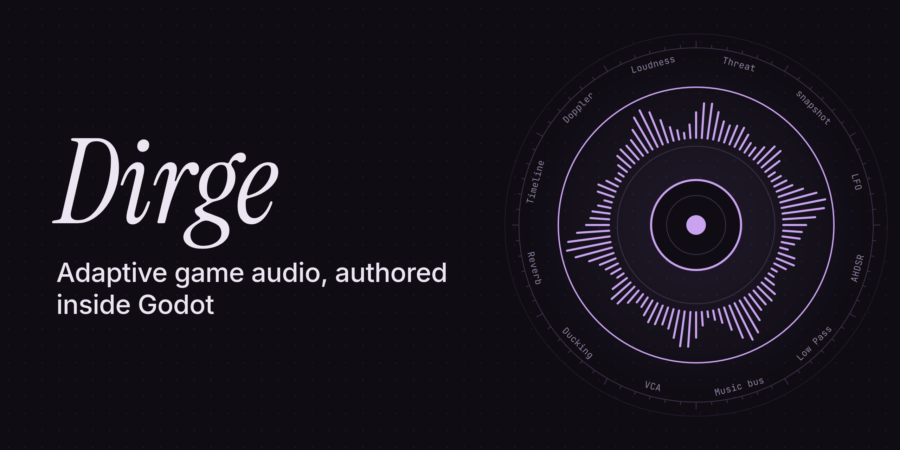
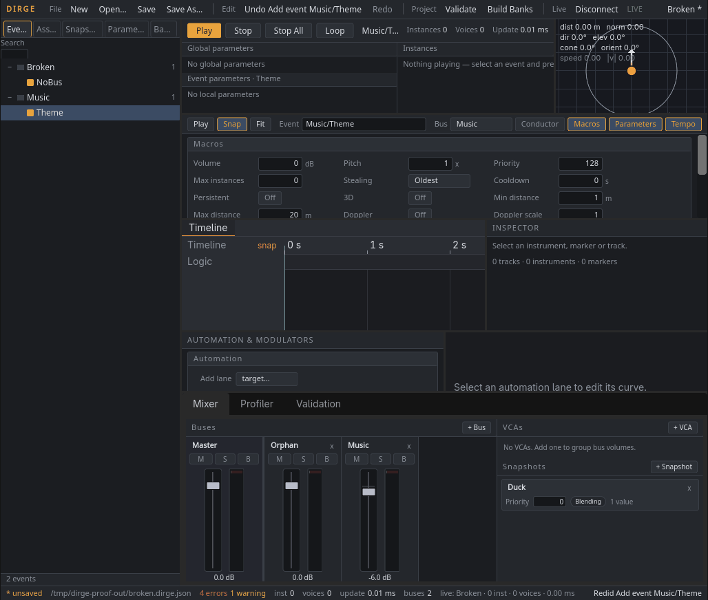
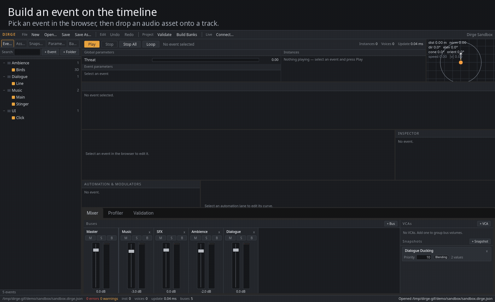
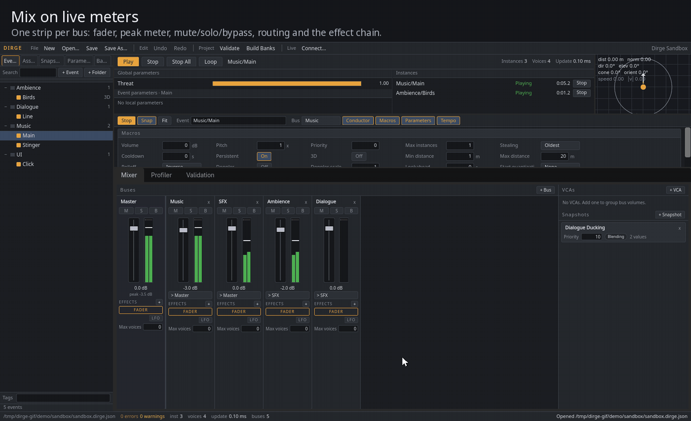
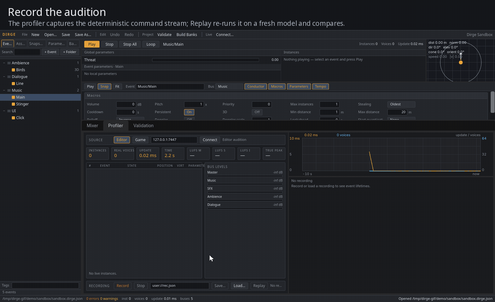
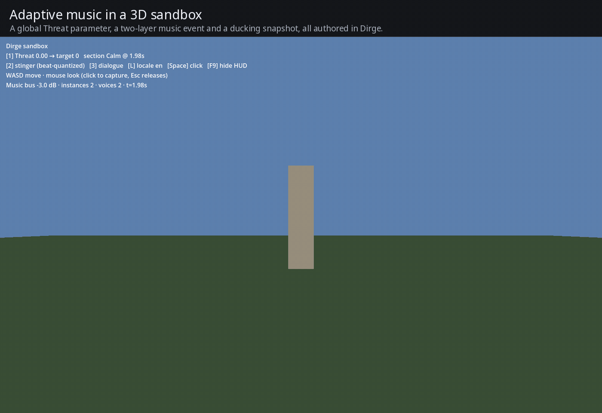

# Dirge



FMOD-Studio-style adaptive audio for Godot 4 .NET. Author events with timelines and parameter sheets, local and
global parameters with automation and modulators, snapshots, VCAs and a mixer graph in an editor main screen, then
play all of it through Godot's own `AudioServer` from GDScript or C#. The authoring tool is built with HTML/CSS
through [NecronomiDOM](https://github.com/Eldritch-Game-Studio/NecronomiDOM), and the same Mixer and Profiler panes
mount over a running game.

**Inspired by [FMOD Studio](https://www.fmod.com/studio), built independently for Godot. No second audio engine: one DSP path, Godot's.**

[Download the addon](https://github.com/Eldritch-Game-Studio/Dirge/releases/latest) · [Getting started](docs/getting-started.md) · [Capabilities and API](docs/capabilities.md) · [Specification](docs/SPEC.md) · [Changelog](CHANGELOG.md)



## Author, audition, mix, profile

### Events on a timeline, parameters on a curve



Drag an asset from the **Browser** onto a track and it becomes a clip instrument. Add a local parameter and an
automation lane: double-click in the curve editor to add points, drag to shape them. **Play** auditions the event
through the real `AudioServer` with the playhead on the timeline, the parameter sliders in the transport and the
meters in the mixer all live.

### A mixer that knows about snapshots



One strip per bus: fader, peak meter, mute/solo/bypass, routing picker, max voices and the effect chain, with every
instantiable `AudioEffect` (plus the Dirge native effects when the extension is loaded) available from `+`. Select a
snapshot and the mixer enters snapshot editing: the controls you touch are **scoped** into it, the authored mix stays
put, and the intensity slider lets you hear the blend.

### Record, replay, and connect to the game



The **Profiler** records the deterministic command stream the model emits and replays it on a fresh model to compare,
so recordings double as regression fixtures. **Live → Connect…** attaches the tool to a running game over localhost:
instance list, voice counts, update time, bus levels and loudness stream in, and fader or effect edits are pushed back
immediately.

### Adaptive music and ducking in a running game



`demo/sandbox/` is a small 3D scene driven entirely by an authored `*.dirge.json`: a global `Threat` parameter
switches a two-layer music event from Calm to Combat on the next beat, a dialogue line raises a ducking snapshot
on the Music bus through a localized programmer sound, and **F9** opens the in-game overlay with the same Mixer and
Profiler panes bound to the game's `DirgeServer`.

The recordings use the stock Godot 4.7.2 .NET editor with Forward+ rendering; captions are outside the interface.

### What's in the box

- **A pure model.** `Dirge.Model` (`addons/dirge/model`) has no Godot reference: project graph, parameters, curves,
  modulators, snapshots, timeline logic, voice scheduling, serialization (`*.dirge.json`), validation, profiler
  recordings and ITU-R BS.1770-4 loudness. Each `Update(dt)` emits a deterministic command stream, which is what the
  unit tests, the profiler replay and the headless smoke tests assert on.
- **A Godot runtime.** `addons/dirge/runtime`: `DirgeServer` drives `DirgeSystem` from `_Process`, `AudioDriver`
  applies the commands to `AudioServer` buses/effects and a pooled set of `AudioStreamPlayer`/`AudioStreamPlayer3D`
  nodes, `BankLoader` preloads streams, `LoudnessCapture` meters Master, `LiveUpdateHost` serves the editor and
  `DirgeOverlay` shows the Mixer/Profiler panes in-game.
- **A tool.** `addons/dirge/tool` adds the **Dirge** main screen to the editor: Browser, Transport with 3D preview
  panner, Event editor, Mixer, Profiler and Validation panel.
- **Optional native effects.** `native/` is a GDExtension adding aux send/return routing and convolution reverb,
  which stock `AudioServer` cannot express.

## Features

- **Events**: timeline and parameter sheets; clip, multi (random/sequential/shuffle), scatterer, silence, nested event,
  programmer, command and snapshot instruments; macros (priority, max instances, stealing, cooldown, persistent, 3D
  distance/rolloff/doppler, lookahead, start quantization); trigger conditions and probability.
- **Music**: tempo markers, loop regions, transition markers and regions with transition timelines, sustain points,
  destination markers, magnet regions; beat/bar/marker quantization against a conductor event; beat and marker
  callbacks.
- **Parameters**: continuous, discrete and labeled; local and global; seek speed and hold; built-ins computed from
  listener and emitter (distance, direction, elevation, cone angle, orientation, speed).
- **Automation and modulators**: curves (linear, smooth, stepped) on any mixer or instrument property; random, AHDSR,
  LFO (tempo-syncable) and autopitch modulators.
- **Mixer**: buses, effect chains with pre/post-fader split, VCAs, snapshots (blending or overriding, priority,
  intensity AHDSR), per-bus voice caps, sends and returns through the native extension.
- **Runtime**: voice pooling and stealing, virtualization, 3D attributes on `AudioStreamPlayer3D`, banks, audio tables
  for localized programmer sounds, sync groups, loudness metering, deterministic seeded playback.
- **Tooling**: editor main screen with undo/redo, validation with stable diagnostic codes, profiler recordings and
  replay, live update over TCP, in-game overlay, `dirge-validate` CLI for CI.

## Requirements

- Godot **4.7.2 .NET** (stock build) and a .NET SDK able to target `net8.0` (`global.json` pins 10.x with roll-forward).
- **NecronomiDOM ≥ 1.1.5** for the editor tool and the in-game overlay. The runtime alone (`DirgeServer`,
  `AudioDriver`, banks, loudness, live update) does not use it.
- Native effects: prebuilt binaries ship in the release ZIP under `addons/dirge/bin/<platform>/` (Linux x64, Windows
  x64, macOS universal); building them yourself needs a C++17 compiler and SCons.
- GDScript-only projects cannot use Dirge: the runtime is C# and needs the .NET edition. GDScript code in a .NET
  project calls the `DirgeServer` autoload directly (see the quick start).

## Add it to your project

1. Download `Dirge-v<version>.zip` from the [latest release](https://github.com/Eldritch-Game-Studio/Dirge/releases/latest)
   and copy its `addons/dirge/` folder into your project.
   The ZIP keeps its README, license, changelog and third-party notices inside `addons/dirge/`; it adds no root-level documents.
2. Install NecronomiDOM into `addons/necronomidom/` from
   [its release ZIP](https://github.com/Eldritch-Game-Studio/NecronomiDOM/releases/latest).
3. Add both build imports to your project's `.csproj`, before `</Project>`:
   ```xml
   <Import Project="addons/necronomidom/NecronomiDom.targets" />
   <Import Project="addons/dirge/Dirge.targets" />
   ```
   `Dirge.targets` builds `Dirge.Model` as its own assembly and compiles `runtime/` and `tool/` into your game assembly.
4. Build (`dotnet build`), then enable **Dirge** in **Project → Project Settings → Plugins**. Enabling registers the
   `DirgeServer` and `DirgeOverlay` autoloads and adds the `dirge/project_path` project setting; disabling removes the
   autoloads.
5. Set **`dirge/project_path`** to your `*.dirge.json` file (the Dirge main screen's **Save As…** writes one).
   `DirgeServer` loads it in `_Ready`, rebuilds the `AudioServer` bus layout from the project's mixer graph (Master
   stays at index 0) and starts updating.

Alternatively place a `DirgeServer` node in a scene and set its `ProjectPath` export; the demo scenes do this.

## Quick start

GDScript, against the autoload:

```gdscript
var wind := DirgeServer.StartEvent("Ambience/Wind")      # int handle, 0 if the event is unknown
DirgeServer.SetParameter(wind, "Intensity", 0.8)
DirgeServer.SetGlobalParameter("Threat", 1.0)
DirgeServer.StartSnapshot("Muffled")
if DirgeServer.IsEventPlaying(wind):
    DirgeServer.StopEvent(wind, false)                     # false = allow fade-out
DirgeServer.StopSnapshot("Muffled")
var stats: Dictionary = DirgeServer.GetStats()           # time, instances, real_voices, update_ms, handles, *_lufs, true_peak_dbtp
```

Handle-started instances also emit signals: `EventStarted(handle)`, `EventStopped(handle)`,
`TimelineMarker(handle, name, position)`, `TimelineBeat(handle, bar, beat, bpm, position)`, `SoundPlayed(handle, asset)`,
`EventVirtualized`/`EventUnvirtualized`/`EventStolen(handle)` and `ProgrammerSound(handle, key)`, which a handler
answers synchronously:

```gdscript
DirgeServer.TimelineBeat.connect(func(handle, bar, beat, bpm, position): print("beat ", bar, ":", beat))
DirgeServer.ProgrammerSound.connect(func(handle, key):
    DirgeServer.SetProgrammerSound(handle, "res://audio/vo/%s_%s.ogg" % [key, TranslationServer.get_locale()]))
DirgeServer.SetCallbackMask(wind, 0)                     # CallbackMask bits; 0 silences this handle's signals
```

C#, with the full instance API:

```csharp
using Dirge.Driver;
using Dirge.Runtime;

var server = GetNode<DirgeServer>("/root/DirgeServer");
DirgeSystem system = server.System;

EventDescription music = system.GetEvent("Music/Theme");
EventInstance instance = music.CreateInstance();
instance.Callback += (sender, callback) =>
{
    if (callback is BeatCallback beat) GD.Print($"bar {beat.Bar} beat {beat.Beat}");
};
instance.Start();
instance.SetParameter("Threat", 1f);
instance.Set3DAttributes(new Attributes3D(position, velocity, forward, up));
system.SetListener(0, new Attributes3D(cameraPosition, cameraVelocity, cameraForward, cameraUp));

instance.Stop(StopMode.AllowFadeout);
instance.Release();                       // destroyed once stopped

SnapshotInstance duck = system.Mixer.StartSnapshot("Duck");
duck.Intensity = 0.5f;
duck.Stop();
```

`Attributes3D` is the model's own vector type (`System.Numerics.Vector3`), so the model stays engine-free; convert
from Godot vectors at the call site. The [getting started guide](docs/getting-started.md) walks through authoring a
bus, an event, a parameter with automation and a snapshot in ten minutes.

## Tool tour

- **Browser** (left): tabs for **Events** (folder tree by path — `+ Event`, `+ Folder`, rename, delete, drag to
  re-parent, tag chips), **Assets** (every audio file under `res://` with its length; **Import lengths** stores them in
  the project so the model can schedule one-shots headless), **Snapshots**, **Parameters** (global) and **Banks**.
  Search filters the tree. Drag an asset onto the timeline to create a clip instrument, or an event to create a nested
  event instrument.
- **Transport** (top): **Play**/**Stop**/**Stop All**, **Loop**, global and per-event parameter sliders,
  instance/voice/update-time readouts and the **3D preview panner** — drag the emitter around the listener to drive the
  built-in `distance`, `direction`, `elevation`, cone angle, orientation and speed parameters while auditioning.
- **Event editor** (center): header with path, bus, **Macros**, **Parameters** (local) and **Tempo** map. Below it the
  timeline tab and one tab per parameter sheet, with tracks, instrument blocks, logic markers and the playhead;
  right-click for **Add instrument** (all eight kinds), **Add marker** (destination, loop, transition, transition
  region, magnet, sustain), **Add tempo marker here**, **Add track**, copy/paste/duplicate/delete and snap-to-grid. The
  **Inspector** edits the selected instrument, marker or track; **Automation & modulators** adds lanes (with a curve
  editor) and random/AHDSR/LFO/autopitch modulators.
- **Mixer** (bottom tab): one strip per bus with fader, peak meter, **M**/**S**/**B**, routing picker, max voices and
  the effect chain (click an effect for its parameter popover; drag effects to reorder, and drag the **FADER** row to
  split the chain into pre- and post-fader effects). **+ Bus**, **+ VCA**, **+ Snapshot**; selecting a snapshot opens
  its editor — touch a fader or effect parameter to scope it, **Capture** scopes every bus volume, set mode, priority
  and the intensity AHDSR, scrub intensity to hear it.
- **Profiler** (bottom tab): live instance list, real-voice count, update-time graph, per-bus levels, LUFS M/S/I and
  true peak, and **Record**/**Stop**/**Save…**/**Load…**/**Replay** for command recordings; the source toggle switches
  between the editor audition and a live game.
- **Validation** (bottom tab) and the **Validate** menu item list `ProjectValidator` diagnostics with stable codes; the
  status bar shows error/warning counts, instance/voice counts and the live-update state.
- **View › Theme** cycles the color theme; **Editor Settings › Dirge › Theme** picks it directly: **Editor** (default —
  derived from the running Godot editor theme, so a Light editor gets a light Dirge), **Dirge Dark**, **Dirge Light**,
  **High Contrast**, or **Custom** from `Theme Background`/`Theme Foreground`/`Theme Accent` (text contrast is kept at
  or above 4.5:1; a failing pair is corrected and warned about once). Every document and canvas re-themes live.
- Shortcuts: `Ctrl+Z`/`Ctrl+Shift+Z`/`Ctrl+Y` undo/redo, `Ctrl+S` save, `Ctrl+C`/`Ctrl+V`/`Ctrl+D`
  copy/paste/duplicate, `Ctrl+A` select all, `Space` play/stop, `Delete`.

## Live update and the in-game overlay

Run the game with `--dirge-live` after the `--` separator (`godot --path . -- --dirge-live` or `--dirge-live=7447`),
or set `LiveUpdatePort` on the `DirgeServer` node. The game listens on localhost TCP (newline-delimited JSON,
protocol 1, default port `7447`). In the editor choose **Live → Connect…**: the tool streams stats and the instance
list into the Profiler, pushes fader and effect changes immediately, replaces the whole project on structural edits
(running events restart at their timeline position, global parameters and snapshots survive) and can start/stop
events, set parameters and start snapshots remotely. `--dirge-verbose` prints driver decisions such as sync-group
plays.

Debug builds get a `DirgeOverlay` autoload. Press **F9** (input action `dirge_overlay`, created if absent) to show the
Mixer and Profiler panes over the running game, bound to the local `DirgeServer`. The overlay is inert in release
builds and under the headless display server.

## Native effects

`native/` builds `libdirge_native` (godot-cpp, C++17) with three `AudioEffect` classes registered through
`addons/dirge/dirge_native.gdextension`:

- `DirgeAudioEffectSend` — `target_bus`, `level_db`, `pre_fader`: copies its bus into a return bus pre- or post-fader.
- `DirgeAudioEffectReturn` — sums every send addressed to its bus.
- `DirgeAudioEffectConvolutionReverb` — `impulse`, `wet_db`, `dry_db`, `gain_db`: partitioned FFT convolution with any
  `AudioStream` as impulse.

The Mixer pane lists them when the extension is loaded. Routing rules (bus order, keep-alive players) are in
[`native/README.md`](native/README.md). Everything else works without the extension.

## Demos

- `demo/demo.tscn` — a looping wind bed on an `Ambience` bus with a low-pass filter, a one-shot click and a `Muffled`
  snapshot (any key clicks, Enter toggles the snapshot). Project data lives in `demo/DemoProject.cs`;
  `demo/demo.dirge.json` is regenerated from it when missing.
- `demo/sandbox/sandbox.tscn` — the 3D sandbox from the recording above: ambience scatterer, two-layer adaptive music
  with a beat-quantized Calm/Combat transition driven by the global `Threat` parameter, ducking snapshot, two-locale
  programmer dialogue through an audio table, UI click. Keys: `1` Threat 0/1, `2` stinger, `3` dialogue, `L` locale
  en/de, `Space` click, `F9` overlay; WASD + mouse look.

Generate the WAVs with `python3 scripts/gen-demo-audio.py` and `python3 scripts/gen-sandbox-audio.py` (the smoke
script does it when they are missing).

## Validate from the command line

```sh
dotnet run --project tools/dirge-validate -- demo/sandbox/sandbox.dirge.json          # one line per diagnostic
dotnet run --project tools/dirge-validate -- demo/sandbox/sandbox.dirge.json --json   # diagnostics array
```

Exit code 0 = no errors (warnings allowed), 1 = at least one error, 2 = usage or parse failure. CI runs it on both
demo projects.

## Building from source

```sh
git clone --recurse-submodules https://github.com/Eldritch-Game-Studio/Dirge.git
cd Dirge
scripts/fetch-deps.sh                  # NecronomiDOM into addons/necronomidom
dotnet build Dirge.slnx                # model, demo, tests, validate CLI
native/build.sh                        # Linux x86_64 debug + release → addons/dirge/bin/linux-x64/
scripts/package.sh --suffix -partial   # Linux-only diagnostic; a full ZIP requires all native targets
```

Other native platforms: from `native/`, run `scons platform=windows target=<target> arch=x86_64` or
`scons platform=macos target=<target> arch=universal` for **both** `template_debug` and `template_release`.
`scripts/package.sh` checks every library referenced by the final ZIP's GDExtension manifest, including debug and
release targets. It also checks that both Mac frameworks contain ARM64 and x86_64 slices, plus a source/hash-matched
Proton qualification receipt for both Windows DLLs. Missing or empty libraries prevent publication of the ZIP.
`scripts/ci-local.sh` runs Linux-only diagnostics directly with local tools.
Tagged `v*` pushes publish only after Linux smoke/native builds, Windows cross-builds and stock-Windows-Godot
demo/sandbox/native smoke under official Proton, portable tests/validation, and both Mac runtime architectures
pass. Proton is compatibility coverage, **not native Windows/MSVC qualification** (see `CONTRIBUTING.md`).
Portable jobs, universal Mac builds, packaging and release use the
local `[self-hosted, macOS, ARM64, eldritch-apple]` runner. Linux jobs and Windows MinGW cross-builds use
`[self-hosted, Linux, X64, eldritch-linux]`; every CI/CD job is local, with no hosted fallback.
PR execution requires the main-defined admission gate, with exact-head manual approval for reviewed forks.

## Verification

```sh
dotnet test tests/Dirge.Model.Tests    # model unit tests
GODOT=/path/to/Godot_v4.7.2-stable_mono_linux.x86_64 scripts/smoke.sh
```

The smoke run imports and builds the project, then runs the demo and the sandbox headless with the Dummy audio driver:
it asserts on the applied command stream and `AudioServer` state (`DIRGE_SMOKE PASS`), then records, replays and
compares a sandbox profiler recording (`SANDBOX_SMOKE PASS`). `GODOT` may be omitted when `godot` is on `PATH`.

On macOS, set `GODOT` to `Godot_mono.app/Contents/MacOS/Godot`. CI runs the demo, sandbox and native
send/return scene on ARM64 and on x86_64 under Rosetta with matching .NET 8 runtimes. Native/managed work on
the shared Apple host runs through `python3 scripts/apple-run.py <command>`, which holds the foreground
`$HOME/.local/state/eldritch-macos/producer.lock` also used by engine/game workers. See
[`CONTRIBUTING.md`](CONTRIBUTING.md) for runner prerequisites and the untrusted-PR policy.

## License

MIT, see `LICENSE`. Third-party components and their licenses are listed in
[`THIRD_PARTY_NOTICES.md`](THIRD_PARTY_NOTICES.md).
